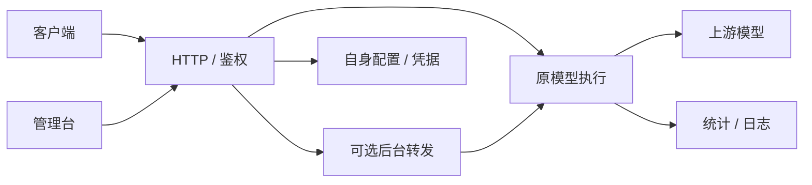

# 架构

- config.js：schema 2、稳定 ID、配置/凭据分离、脱敏导出。新安装默认 3000 端口；读取旧版本自身配置时去掉废弃字段并保留现有模型及凭据。
- server.js：免登录管理与自动 CSRF、Host/Origin 校验、标准 API、导出、单模型接口测试。
- gateway.js：令牌权限、模型映射、优先级/同级权重、Key 轮询、HTTP/SSE、期限和取消。
- forwarding.js：源模型匹配、可选目标、独立并发、异步执行和元数据状态。直接调用 Gateway，不重入 HTTP，防止递归。
- batch.js：显式有限测试，最多 100 次/五分钟。
- telemetry.js：模型调用、上游尝试、后台转发、精确/未知 usage、时间桶与轮转日志。
- desktop.js：Windows 隐藏启动、现有实例识别、Docker Compose 启动与打开浏览器。
- cli.js：前台诊断、所属实例启停；Docker 实例交给 Compose。

## 转发边界

每条合法主请求先取得主调用资格，后台转发异步执行，不等待目标输出。主请求上限由 settings.max_concurrency 控制，后台上限由 forwarding.max_concurrency 控制；两者独立有界。后台超过上限直接跳过。

配置为 forwarding.enabled、source_models（空数组=全部）、target_model、max_output_tokens、max_concurrency。源和目标使用同一个身份做分组/模型白名单校验。请求目标等于源时跳过。

转发复制完整请求，使用同一协议，只替换 model、流式读取和输出限额。结果正文直接丢弃，usage 与状态单独进入日志。来源标为 forward，并通过 request_id 关联主调用；原响应不包装成多候选结构。

后台 Key 的鉴权/冷却状态按转发目标隔离，避免目标模型故障把主模型使用的 Key 一起冷却。主请求和转发都会响应客户端中途断开；正常响应结束不会取消尚未完成的后台调用。停止服务等待这些调用中止并记录统计后再落盘。

## 持久化

config.json 只存非密钥参数和稳定 ID，secrets.json 存引用值；更换密钥创建新 ID。先保存新凭据，再原子替换元数据，并保留上一版所需引用。不生成管理凭据；启动时删除旧版遗留管理密钥文件。stats/runtime 每秒快照，退出时保存。

总模型调用包含主调用和后台调用，forwarded 单列；attempts/retries 不重复算逻辑调用。缓存 Token 是输入的子集，缺 usage 为未知。日志只含元数据，轮转/期限受设置约束，不记录请求正文。

## 部署

本地默认仅监听 127.0.0.1。容器显式 TOKENHUB_HOST=0.0.0.0，Compose 默认只向宿主 127.0.0.1 发布；外部 origin 须明确列在 TOKENHUB_PUBLIC_URL。镜像不包含 data，绑定卷负责私有数据，node 非 root 用户运行。

## Key 使用状态与成功率

Gateway 为每次实际上游尝试维护进程内活动记录，主调用、后台转发、连通测试分列。重试切换、完成、错误、取消均在 finally 清除，活动状态不落盘，重启不会留下虚假的正在使用。

Key 的统计汇总主调用与各后台健康分区的 ok/fail。成功率为 ok/(ok+fail)，包含连通测试和重试的已结束尝试，取消与超时计失败，尚未结束不计入。无样本显示 —。健康状态仍使用主调用分区，后台失败不会将主模型 Key 一起冷却。页面显示已结束/成功/失败计数，避免连通测试与模型尝试数混用。

## 按 Key 分配重试预算

max_attempts 在每个选中的 Key 上独立计数（包含首次），各渠道/Key 间不再共用总尝试上限。Key 只进入一次：所有上游非 2xx 状态码和连接错误均先在该 Key 上重试，耗尽后沿路由降级；请求仍受整体期限、取消和有限 Key 数约束。400/401/403/404 与 429/5xx 使用同一预算。401 仅保留最近鉴权错误标记，路由仅检查启停与冷却期限，冷却结束自动重新参与选择（兼容旧鉴权标记）。本地令牌、权限、请求参数和协议桥接校验失败直接返回；成功上游响应被接受后不重放。

429 等待优先采用 Retry-After，缺省使用 retry_interval_ms=1000。活动记录覆盖同 Key 的整个尝试和等待周期，retrying/next_retry_at 描述等待；所有退出分支清理该记录。每次实际上游尝试独立更新统计，等待不增加尝试计数。后台转发继续使用独立健康分区与并发限制。
